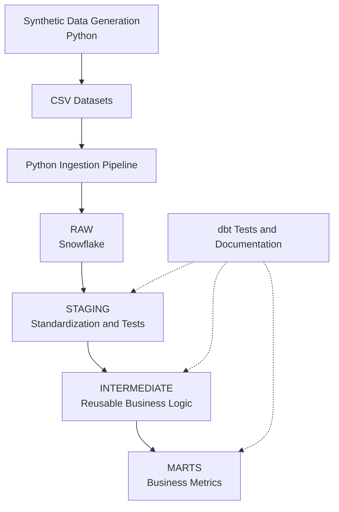

# PulseMetrics — SaaS Analytics Engineering

PulseMetrics is an analytics engineering portfolio project that demonstrates how raw operational data can be transformed into reliable, tested, and documented business metrics for a fictional B2B SaaS company.

The project combines synthetic data generation, Python-based ingestion, Snowflake, and dbt to model subscription revenue, customer activity, and customer churn.

## Tech Stack

- **Data warehouse:** Snowflake
- **Transformation and modeling:** dbt Core, SQL, dbt_utils
- **Data generation and ingestion:** Python, pandas, Snowflake Connector
- **Data quality:** dbt data tests, custom SQL tests, dbt unit tests, and enforced model contracts
- **Documentation:** dbt model documentation and metric methodology

## Architecture

The project follows a layered data modeling approach that separates ingestion, source standardization, reusable business logic, and business-facing analytical models.



### Data Layers

| Layer | Purpose |
|---|---|
| `RAW` | Stores source datasets loaded from CSV files into Snowflake. |
| `STAGING` | Standardizes source fields and applies foundational data quality checks. |
| `INTERMEDIATE` | Implements reusable transformations for billing periods, subscription lifecycles, customer revenue, activity, and churn, plus a shared reporting calendar. |
| `MARTS` | Exposes business-facing monthly revenue and customer churn metrics, materialized as tables with enforced contracts. |

## Data Model

The synthetic source datasets represent a subscription-based SaaS business.

| Dataset | Description |
|---|---|
| `CUSTOMERS` | Customer attributes and creation timestamps. |
| `PLANS` | Subscription plans and monthly prices. |
| `SUBSCRIPTIONS` | Customer subscriptions, plans, and lifecycle dates. |
| `PAYMENTS` | Billing periods, payment attempts, amounts, statuses, and payment methods. |
| `PRODUCT_EVENTS` | Customer product activity events and event properties. |

The data generation process produces repeatable CSV-based inputs for the ingestion pipeline. The data is synthetic and does not represent real customers or transactions.

## Key Business Metrics

### Monthly Revenue

- **Contracted MRR:** The monthly run rate of subscriptions active at the end of a completed month. Revenue is not prorated, and payment attempts do not directly determine MRR.
- **Active subscriptions:** Subscriptions active at the same month-end snapshot.
- **Active customers:** Customers with at least one active subscription at that snapshot.
- **ARPA (Average Revenue Per Account):** Month-end contracted MRR divided by month-end active customers.

### Customer Churn

Customer churn is modeled as a proxy because the synthetic source data does not contain an explicit cancellation event.

The model reconstructs continuous customer activity periods from subscription start and end dates. Same-day subscription changes are treated as continuous activity.

The monthly churn rate is calculated as:

**Customers churned during the month ÷ customers active immediately before the month began**

The numerator is restricted to customers belonging to the opening customer base. Reactivation is recognized only when a subsequent activity period has started by the as-of date.

Monthly revenue and churn marts exclude the incomplete as-of month and future months. The as-of date defaults to the current date and can be fixed for reproducible results (see [Reproducing Metrics for a Fixed Date](#reproducing-metrics-for-a-fixed-date)).

See [`docs/metrics/customer_churn.md`](docs/metrics/customer_churn.md) for the churn methodology, assumptions, and limitations.

## Data Ingestion and Reliability

The Python ingestion pipeline validates input datasets before performing warehouse operations.

Its main safeguards include:

- Validation of expected input files and column schemas.
- Checks for required values, dates, and JSON fields.
- Loading into temporary replacement tables.
- Row-count validation against the input datasets.
- Transactional replacement of the RAW tables after successful validation.

This design reduces the risk of replacing existing RAW data with incomplete or invalid input.

The ingestion pipeline uses key-pair authentication. Private keys and passphrases must remain outside version control.

## Data Quality and Testing

Quality checks are layered so that each kind of failure is caught where it is cheapest to detect.

| Check | Where | What it protects |
|---|---|---|
| Data tests | Staging | Keys are present and unique, relationships between sources hold, and categorical fields use accepted values. |
| Grain tests | Intermediate | Each model has exactly one row per declared grain (for example, one row per customer and month), so marts cannot double count. |
| Custom SQL tests | Intermediate and marts | Business rules hold: completed months only, consistent churn and reactivation fields, and ARPA and churn rates that reconcile with their components. |
| Unit test | `int_customer_activity_periods` | The subscription-merging logic behind churn behaves as documented on fixed inputs. |
| Model contracts | Marts | Column names, data types, and not-null constraints are enforced when the marts are built. |

### Model Contracts

Both marts declare an enforced dbt contract. The build fails if a column is renamed, removed, or changes type, instead of silently changing the tables that downstream consumers read.

Data types include numeric precision, such as `number(38,2)` for contracted MRR, so values are not rounded when the table is created. Snowflake enforces `not_null` constraints but not `unique` constraints, so uniqueness of `month_start` remains covered by a data test.

### Unit Test for Activity Periods

Customer churn depends on how subscriptions are merged into continuous activity periods. The unit test `test_activity_periods_merge_rules` runs this logic on fixed subscriptions and checks that:

- Overlapping subscriptions form a single period.
- A subscription starting on the day the previous one ends continues the same period.
- A gap between subscriptions starts a new period.
- A short subscription nested inside a longer one does not split the period.
- An open-ended subscription keeps the period open.

Run only the unit tests with:

```bash
dbt test --select "test_type:unit"
```

### Ingestion Unit Tests

The ingestion safety unit tests can be run locally without connecting to Snowflake:

```bash
python -m unittest discover -s data_generation/tests -v
```

The unit tests validate ingestion behavior; they are not a substitute for running the pipeline against a live warehouse.

## Getting Started

### Prerequisites

- Python and the dependencies used by the data generation and ingestion scripts.
- dbt Core and the Snowflake adapter.
- A Snowflake account with the required database, schemas, warehouse, roles, and permissions.
- A configured dbt profile named `pulsemetrics`.
- A private key configured for Snowflake key-pair authentication.

### 1. Generate the Synthetic Data

From the repository root:

```bash
python data_generation/generate_data.py
```

The script writes CSV files to `data_generation/output/`.

### 2. Configure Ingestion Credentials

Place the private key at:

```text
.secrets/rsa_key.p8
```

Set the private key passphrase as an environment variable. For example, in a shell session:

```bash
export DBT_SNOWFLAKE_PRIVATE_KEY_PASSPHRASE='your-private-key-passphrase'
```

Replace the example value with your actual passphrase. Do not commit the passphrase or private key to Git.

The ingestion script is configured to connect to the `PULSEMETRICS` database and `RAW` schema using the `PULSEMETRICS_INGEST` role and `PULSEMETRICS_WH` warehouse. Review the script and infrastructure configuration before using a different environment.

### 3. Load the RAW Tables

```bash
python data_generation/load_raw.py
```

The loader validates the datasets, loads temporary tables, checks row counts, and replaces the RAW tables after successful validation.

**Note:** This step requires a working Snowflake connection and an active, appropriately configured warehouse.

### 4. Run dbt

From the repository root, with the dbt profile and Snowflake environment configured:

```bash
dbt deps
dbt debug
dbt compile
dbt build
```

- `dbt deps` installs the dbt packages declared in `packages.yml`.
- `dbt debug` checks the project and connection configuration.
- `dbt compile` compiles the models and tests.
- `dbt build` runs the models, data tests, and unit tests in dependency order.

These commands require a working Snowflake connection for warehouse-backed operations. They are provided as reproduction instructions, not as a guarantee that the warehouse is currently active.

### Reproducing Metrics for a Fixed Date

Every "completed month" and "has already happened" rule in the models and tests uses a single as-of date. It defaults to the current date. To reproduce the metrics as they were on a specific day, pass it as a variable:

```bash
dbt build --vars '{"as_of_date": "2026-09-30"}'
```

## Repository Structure

```text
data_generation/   Synthetic data generation, ingestion, and unit tests
docs/              Metric definitions and methodology
infrastructure/    Snowflake setup, tables, roles, and permissions
macros/            Custom dbt macros (schema naming, as-of date)
models/
  staging/         Source standardization and foundational tests
  intermediate/    Reusable business logic
  marts/           Business-facing analytical models
tests/             Custom SQL data quality tests
packages.yml       dbt package dependencies
```

## Current Status

Implemented:

- Synthetic data generation for customers, plans, subscriptions, payments, and product events.
- Snowflake RAW ingestion pipeline with validation and safer replacement logic.
- dbt staging, intermediate, and mart models.
- Monthly contracted revenue and customer churn proxy metrics.
- Business metric documentation and data quality tests.
- Grain tests for every intermediate model.
- Enforced data contracts on both marts.
- dbt unit test for the activity-period logic behind churn.
- Shared reporting calendar and configurable as-of date for reproducible metrics.
- Local unit tests for ingestion safety.

Planned improvements:

- Additional business-facing marts and analytical insights.

## Scope and Limitations

PulseMetrics is a learning and portfolio project designed to demonstrate data modeling, metric definition, testing, and ingestion reliability.

The source data is synthetic. Customer churn is an inferred proxy rather than a directly observed cancellation event, and the project does not claim to represent a production SaaS data platform in its entirety.